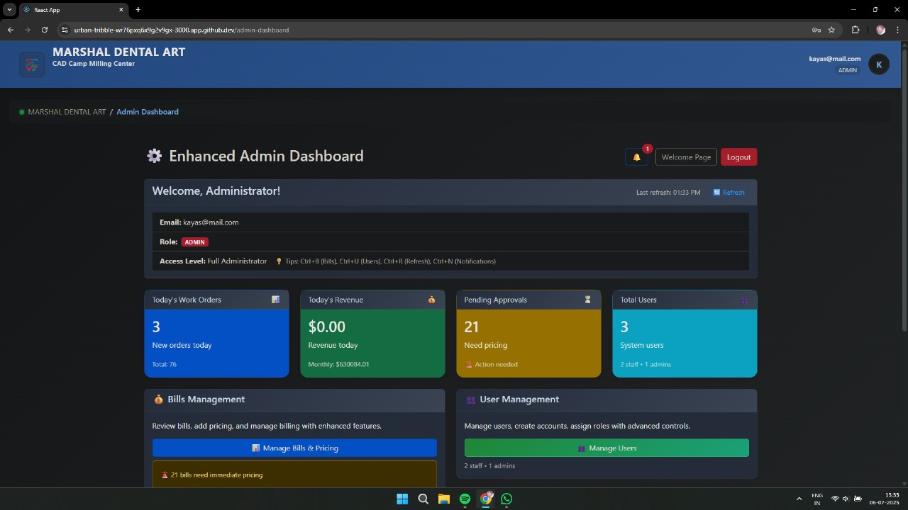
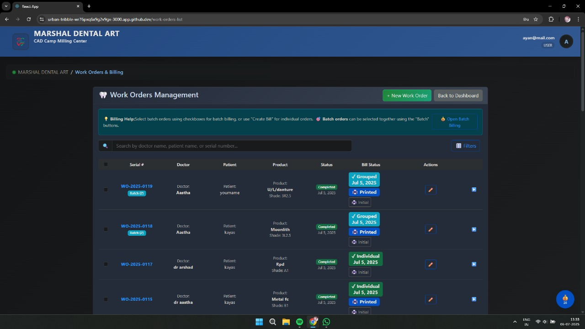
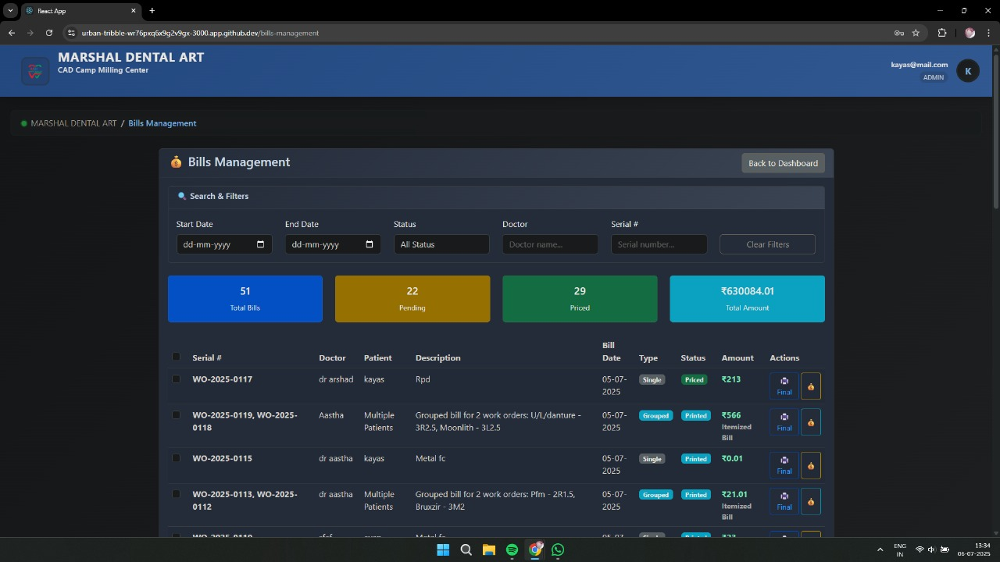
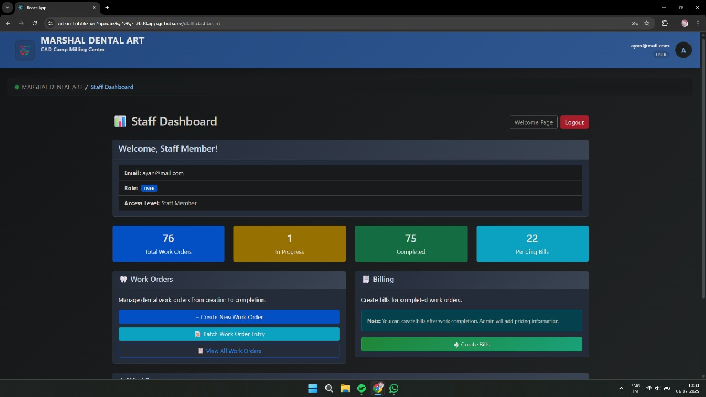
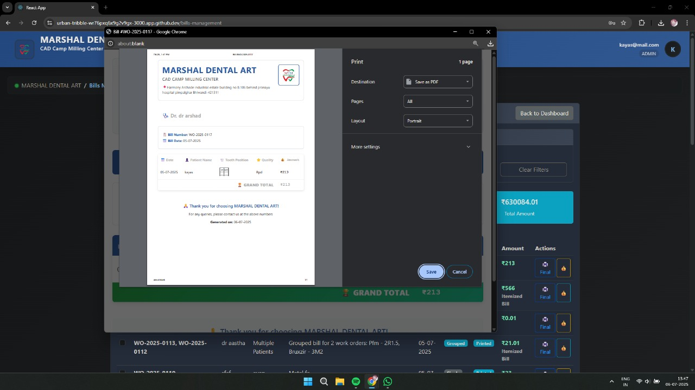

# Dental Lab Management System

A work-order and billing app for a commercial dental lab that was running the whole process on handwritten records.

Staff take an order when a dentist sends work in. They record the doctor, patient, product, shade, serial, teeth, and any trial dates. When the case is done they update that row and open a bill. The admin prices it, prints it, and sends it out with the finished work. Staff never see prices.

There is no public login. Walkthrough: [demo video](https://github.com/user-attachments/assets/32b640ce-aa08-4ff1-8b6d-4cbfb58ed4d6).



## How the lab actually works

1. Dentist places an order.
2. Staff log it (including an odontogram, not just a text note).
3. Work moves through trial / complete dates. Overdue unfinished cases are visible.
4. Staff open a bill entry. Admin enters amounts.
5. Admin prints the bill. Several bills can land on the same day, so they can be listed and searched by date.

Staff print an unpriced slip for the bench. Admin prints the priced invoice for the clinic.

<p>
  
  
</p>
<p>
  
  
</p>

## Stack

React 18, React Router, CSS modules  
Supabase Auth + Postgres  
Row Level Security so pricing stays admin-only even if someone tampers with the UI  
Odontogram state in `src/components/ToothSelector.js`  
Print layout in `src/components/bills/BillPrintUtils.js`

## Repo layout

```
src/                  React app
public/
supabase/sql/schema/      base schema
supabase/sql/migrations/  incremental changes
supabase/sql/fixes/       RLS / repair scripts
supabase/sql/ops/         one-off admin SQL
scripts/                  local debug helpers
docs/screenshots/
demo/                     recorded walkthrough
```

## Run locally

```bash
npm install
```

Create `.env`:

```
REACT_APP_SUPABASE_URL=
REACT_APP_SUPABASE_ANON_KEY=
```

Apply `supabase/sql/schema/dental_lab_schema.sql` in the Supabase SQL editor, then the files in `supabase/sql/migrations/` if you are building a fresh project.

```bash
npm start
```

Opens at `http://localhost:3000`.

## Notes

- Built for one lab client (2025). It is not a hosted SaaS.
- Pricing access is enforced in Postgres RLS, not only in React.
- `scripts/` and `supabase/sql/ops/` are leftovers from setup and debugging. Don’t run ops SQL on a live database unless you know what it does.
